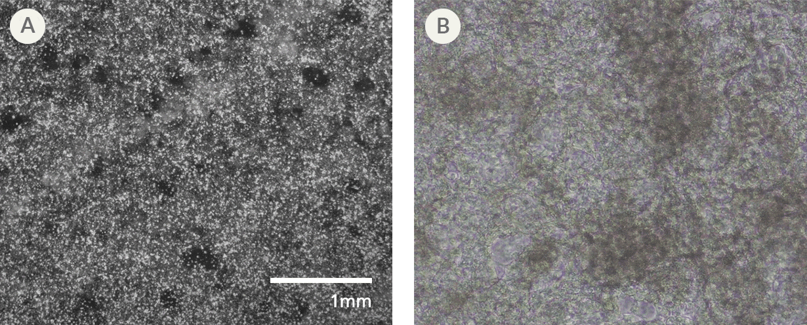

## 2026-10-12 https://github.com/Ayzhu-UW/tcfb_2026_demo/issues/1

## Reagents

| reagent | vendor | catalog number | stock concentration | final concentration |
| --- | --- | --- | --- | --- |
| mTeSR™ Plus | StemCell | 100-0276 | N.a. | N.a. |
| RPMI 1640 Medium | Gibco | 11875093 | N.a. | N.a. |
| RPMI 1640 Medium, no glucose | Gibco | 11879020 | N.a. | N.a. |
| CHIR99021 | Sigma-Aldrich | SML1046 | 25mM | 1-5uM |
| Y-27632 Dihydrochloride | Selleckchem | S1049 | 20mM | 10uM |
| Wnt-C59 | Selleckchem | S7037 | 5mM | 2uM |
| Bovine Serum Albumin | Sigma-Aldrich | A4737 | 40mg/mL | 500ug/mL |
| L-Ascorbic acid | Sigma-Aldrich | A4403 | 5mg/mL | 213ug/mL |
| B-27™ Plus Supplement (50X) | Gibco | A3582801 | 50x | 1x |
| Sodium L-lactate, 98+% | Thermo Scientific Chemicals | L14500.14 | 40mM | 4mM |
| Falcon® 24-well Clear Flat Bottom TC-treated Multiwell Cell Culture Plate, with Lid | Corning | 353047 | N.a. | N.a. |
| Falcon® 100 mm TC-treated Cell Culture Dish, Sterile | Corning | 353003 | N.a. | N.a. |
| DMEM/F-12 | Sigma-Aldrich | D0697 | N.a. | N.a. |
| Corning® Matrigel® Basement Membrane Matrix, LDEV-free, 10 mL | Corning | 354234 | 30X | 1X |
| Versene Solution | Gibco | 15040066 | N.a. | N.a. |
| Gibco™ HBSS, calcium, magnesium, no phenol red | Gibco | 14025092 | N.a. | N.a. |

## Procedure
1. Coat well plates and dishes with Matrigel diluted to 1X in DMEM/F-12 before incubating at 37C for at least 30min
2. Prepare mTeSR Plus with 10uM Y-27632 (mTeSR+Y) (~25mL per cell line)
3. Wash confluent plated iPSCs with HBSS before adding 5mL Versene and incubating for 5min at 37C
4. Discard 3mL Versene and incubate for another 5min at 37C
5. Add 3mL of mTeSR+Y and gently resuspend cells from plate to count (using hemocytometer or other cell counter)
6. Seed cells at gradient of densities in coated 24 well plates (ranging from 50-200k cells/well; suggested gradient of 50, 100, 150, and 200k w/ 6 replicates each) and seed a maintenance plate at desired density
7. Procede to cardiomyocyte differentiation following the protocol [here](https://pmc.ncbi.nlm.nih.gov/articles/PMC4597313/)

## Result

Successful differentiations should look like this (Taken from StemCell Technologies' guide to optimizing iPSC-CM differentiation)

